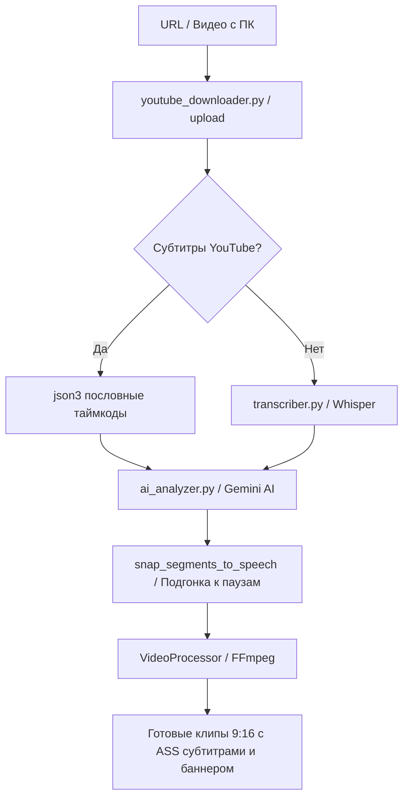

# 🎬 videopril — AI Video Highlight Clipper & Shorts Generator
> **Документация и технические инструкции для ИИ-агентов**  
> *Версия: 2.0 | Проект: videopril*

---

## 📌 1. Обзор проекта и архитектура

**videopril** — это веб-приложение на базе AI для автоматической и ручной нарезки длинных видеофайлов (с YouTube, VK, TikTok или ПК) на вертикальные клипы для YouTube Shorts, Reels и TikTok (формат 9:16).

### 🛠️ Технологический стек:
- **Frontend**: React 18 + Vite (Vanilla CSS, Glassmorphism UI, HSL цвета).
  - Прокси в `vite.config.js`: перенаправляет `/api`, `/clips`, `/uploads`, `/thumbs`, `/ws` на бэкенд `http://127.0.0.1:8000`.
- **Backend**: FastAPI (Python 3.12) на сервере Uvicorn (`http://127.0.0.1:8000`).
- **Обработка видео**: FFmpeg + FFprobe (вызов через `subprocess`).
- **Транскрипция речи**: 
  1. Субтитры YouTube (формат `json3` с пословными таймкодами — загружаются за 2 сек).
  2. `faster-whisper` (модель `small` — локальный фоллбэк, если субтитров YouTube нет).
- **ИИ-анализ моментов**: Google Gemini API (`gemini-2.5-flash` / `gemini-1.5-flash`) или DeepSeek API.

---

## 🚀 2. Запуск и окружение

### Запуск приложения:
Главный батник в корне проекта:
```cmd
x:\videopril\start.bat
```
Он последовательно запускает:
1. `backend/start_backend.bat` (FastAPI утилитой `uvicorn main:app --host 0.0.0.0 --port 8000`).
2. `npm run dev` в папке `frontend` (Vite dev-сервер).

### Ключевые пути и переменные:
- **Временные файлы и кэш моделей**: жестко привязаны к диску `X:` для избежания переполнения диска `C:`:
  - `X:\videopril\temp` — временные файлы нарезки.
  - `X:\videopril\models_cache` — кэш моделей `faster-whisper` (HuggingFace).
- **Файлы сервера**:
  - `backend/uploads/` — оригинальные загруженные/скачанные видео.
  - `backend/clips/` — готовые нарезанные ролики.
  - `backend/transcripts/` — сохранённые JSON-транскрипты.
  - `backend/ads/` и `backend/banners/` — текущие рекламные ролик и видео-баннер.

---

## ⚙️ 3. Полный конвейер работы (Data Flow)



1. **Загрузка видео**:
   - `youtube_downloader.py`: с помощью `yt-dlp` скачивает видео и субтитры. Приоритетный формат субтитров — `json3` (содержит `tOffsetMs` для каждого слова).
2. **Получение транскрипта**:
   - Если есть субтитры YouTube, Whisper **не запускается** (экономия 10–25 минут времени).
   - Если субтитров нет, `transcriber.py` запускает `faster-whisper`.
3. **ИИ-поиск историй (`ai_analyzer.py`)**:
   - ИИ анализирует текст транскрипта с таймкодами и ищет завершённые истории (подводка + завязка + кульминация + вывод).
4. **Сглаживание границ (`snap_segments_to_speech`)**:
   - Функция в `main.py` сдвигает точки `start` и `end` к ближайшим паузам в речи (максимум на 2.5 сек), чтобы видео не начиналось и не обрывалось на полуслове.
5. **Экспорт и наложение медиа (`video_processor.py`)**:
   - Нарезка клипа с заполнением кадра 9:16 (black padding).
   - Генерация снимированного файла субтитров `.ass` (`_create_ass_subtitles`).
   - Наложение зацикленного видео-баннера сверху (`insert_video_banner`).
   - Наложение плавающего рекламного текста (`_create_text_ad_filters`).
   - Вставка видео-рекламы в середину (`insert_ad_into_clip`).

---

## 🛠️ 4. Проблемы, решённые в процессе разработки (Gotchas & Fixes)

### 🔴 Проблема 1: Клипы 2, 3, 4+ нарезались без вставок или рассыпались
- **Симптом**: Первый клип (`start=0`) нарезался идеально, а все последующие ролики (начинающиеся с `t_start > 0`) получали рассинхрон субтитров, отсутствие баннеров или некорректный хронометраж.
- **Причина**: При `-ss t_start` перед `-i` декодер FFmpeg передавал видеокадры со смещенными временными метками (`PTS = 300s, 600s...`). Субтитры `.ass` и оверлеи рассчитывались от `0.0s`, из-за чего для клипов 2+ фильтры и наложения не совпадали по времени.
- **Решение**: В `video_processor.py` в начало фильтра добавлены `setpts=PTS-STARTPTS` и `-af asetpts=PTS-STARTPTS`. Это гарантированно сбрасывает метки кадров в `0.000s` для **любого клипа**, независимо от его стартовой позиции в исходном видео.

### 🔴 Проблема 2: Одиночное скачивание клипа сбрасывало баннеры и рекламу
- **Симптом**: При пакетном экспорте ролики нарезались с баннерами, но при клике на кнопку «⬇ Скачать» на конкретной карточке момента скачивался ролик без баннера.
- **Причина**: В `App.jsx` функция `handleDownloadSingleIndex` передавала базовые параметры (`video_id`, `segments`, `aspect_ratio`), но не передавала `video_banner_enabled`, `video_banner_height`, `text_ad_enabled` и т.д.
- **Решение**: В `App.jsx` в payload функции `handleDownloadSingleIndex` добавлены все параметры оверлеев и рекламных баннеров.

### 🔴 Проблема 3: Маленький прямоугольник видео-баннера на Shorts
- **Симптом**: Верхний видео-баннер на 9:16 видео отображался в виде крошечного квадрата в центре чёрного поля.
- **Причина**: Баннер масштабировался с флагом `decrease`, что сжимало 16:9 видео до 355px ширины на кадре 720px.
- **Решение**: В `insert_video_banner` добавлена авто-обрезание чёрных полей самого баннера (`_get_banner_crop`) и масштабирование на всю ширину клипа (`target_w = clip_w * 0.98`), а высота по умолчанию увеличена до `380px`.

### 🔴 Проблема 4: Ошибки путей субтитров FFmpeg в Windows
- **Симптом**: При вшивании `.ass` субтитров FFmpeg падал с ошибкой фильтра.
- **Причина**: Относительные пути или неэкранированные двоеточия дисков (`C:/...`) в Windows разрывали синтаксис фильтра `subtitles=`.
- **Решение**: Использование вызова `Path(temp_ass_file).as_posix().replace(":", "\\:").replace("'", "\\'")` и заключение пути в одинарные кавычки (`subtitles='C\:/...'`).

### 🔴 Проблема 5: Повторный выбор одного и того же файла в React
- **Симптом**: Нажатие кнопки «Сменить» не открывало окно заново, если имя файла совпадало.
- **Причина**: В `<input type="file" />` сохранялся старый `event.target.value`.
- **Решение**: В `VideoUploader.jsx` добавлен сброс `e.target.value = ''` при открытии и добавлена кнопка «🔄 Сбросить / Другое видео», вызывающая `handleResetVideo`.

---

## 🚨 5. Текущий статус и известные нюансы для нового ИИ

1. **Кодирование видео**: Все клипы всегда перекодируются через `-c:v libx264 -preset ultrafast -pix_fmt yuv420p`. Это гарантирует наличие ключевого кадра (IDR-frame) на `0.0s`, исключая эффект «чёрного экрана» при запуске в HTML5 плеерах и мобильных устройствах.
2. **Сессия React**: В `App.jsx` используется `localStorage` (`videopril.session.v1`) для восстановления выбранного видео, транскрипта и клипов при перезагрузке страницы.
3. **Ошибки портов**: При перезапуске сервера проверяйте, что порт `8000` не занят осиротевшими процессами Python.

---

## ⏯ 6. Управляемые операции Whisper

Явный запуск `/api/video/transcribe` создаёт фоновую операцию и сразу возвращает
её `operation_id`. Состояние операции хранится в памяти `OperationManager`, а
события WebSocket содержат `operation_id` и `video_id`, поэтому вкладки не
смешивают прогресс.

Доступные состояния транскрипции: `queued`, `running`, `paused`, `stopped`,
`completed`, `failed`, `cancelled`. Управление выполняется через:

- `POST /api/operations/{operation_id}/pause`;
- `POST /api/operations/{operation_id}/resume`;
- `POST /api/operations/{operation_id}/stop`;
- `GET /api/operations/{operation_id}`;
- `GET /api/operations?video_id=...&active=true`.

Пауза и остановка кооперативные: уже вычисляемый сегмент Whisper заканчивается,
после чего worker реагирует на команду. При остановке частичный результат и
checkpoint остаются только в памяти backend. Продолжение запускается с
перекрытием в одну секунду и удаляет повторный сегмент на границе. Финальный
JSON записывается атомарно только после полного завершения.

Обновление frontend не уничтожает операцию. Перезапуск backend намеренно
очищает все незавершённые операции; постоянное хранение checkpoint в этой
версии не предусмотрено.
